# operaciones basicas con opencv en python
## alumno catherine rascon NC 0072
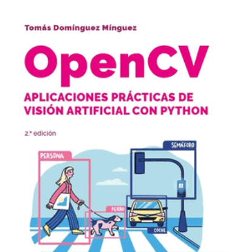

# 1. LECTURA DE LA IMAGEN DESDE LA CARPETA
## cuando no puede cargar la imagen
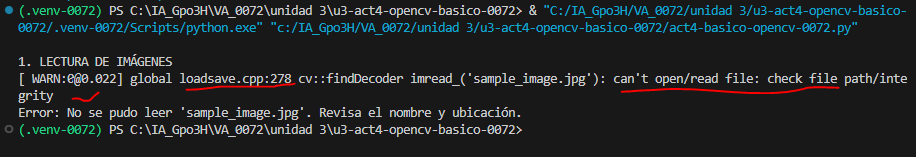

## cuando puede leer la imagen
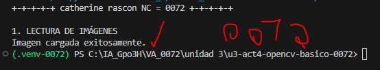

# 2. PROPIEDADES DE LA IMAGEN
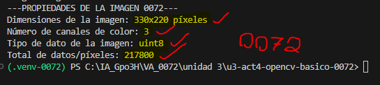

# 3. VISUALIZACIÓN DE LA IMAGEN ORIGINAL
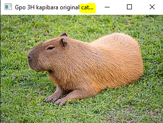

# 4. ACCESO Y MODIFICACIÓN DE PÍXELES INDIVIDUALES
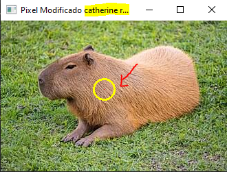
## terminal 
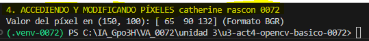

# 5. REGIÓN DE INTERÉS (ROI - REGION OF INTEREST)
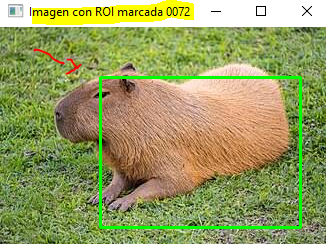
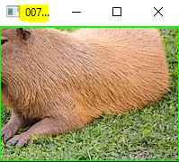

# 6. SEPARACIÓN Y FUSIÓN DE CANALES DE COLOR (BGR)
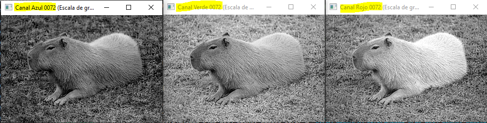
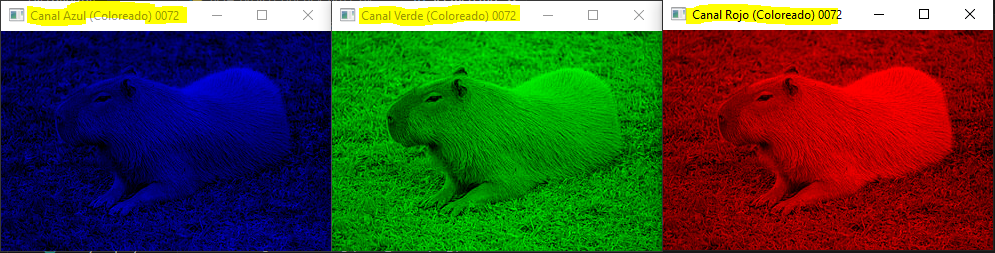

# 7. REDIMENSIONAMIENTO DE IMÁGENES (RESIZING)
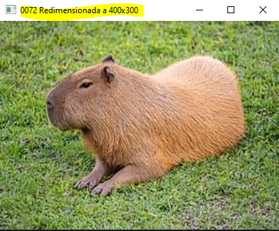
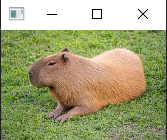
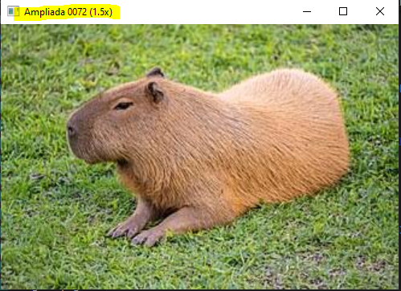

# 8. ROTACIÓN DE IMÁGENES
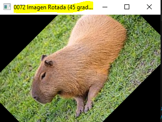

# 9. VOLTEO / ESPEJO DE IMÁGENES (FLIPPING)
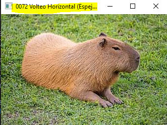
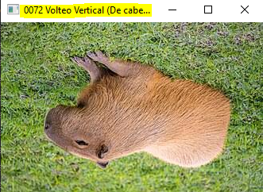
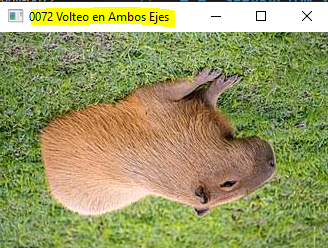

# 10. GUARDADO DE RESULTADOS Y LIMPIEZA
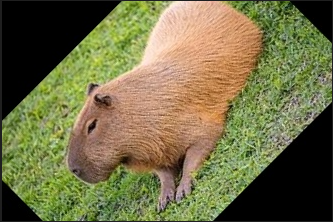
## terminal
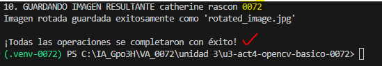